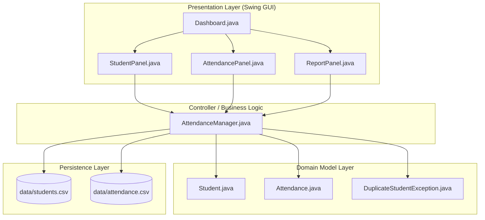
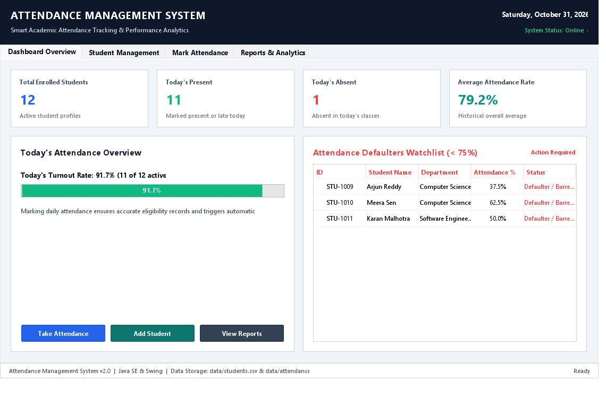
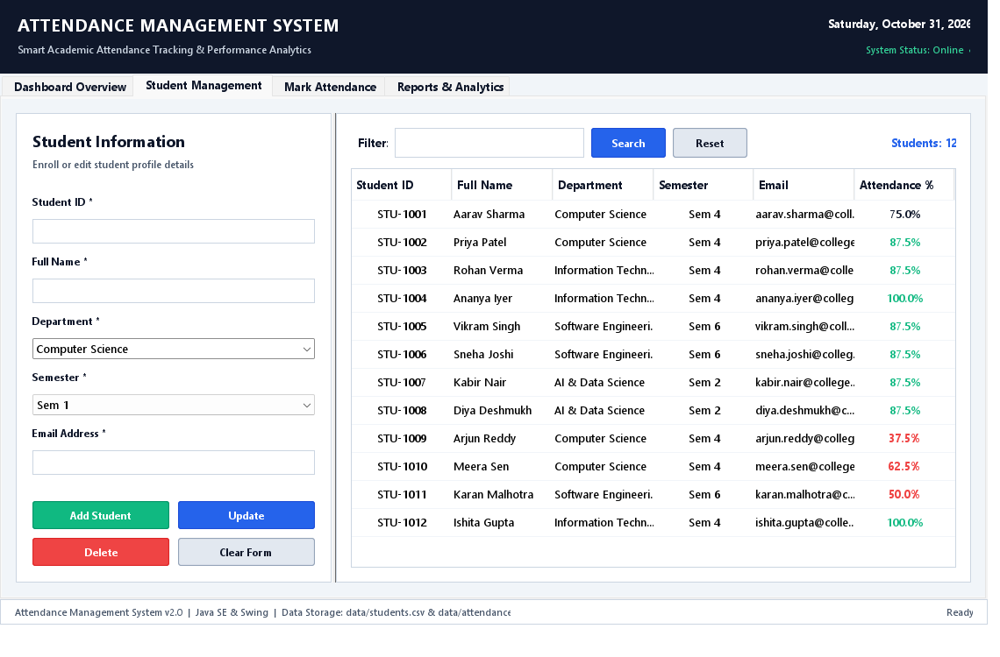
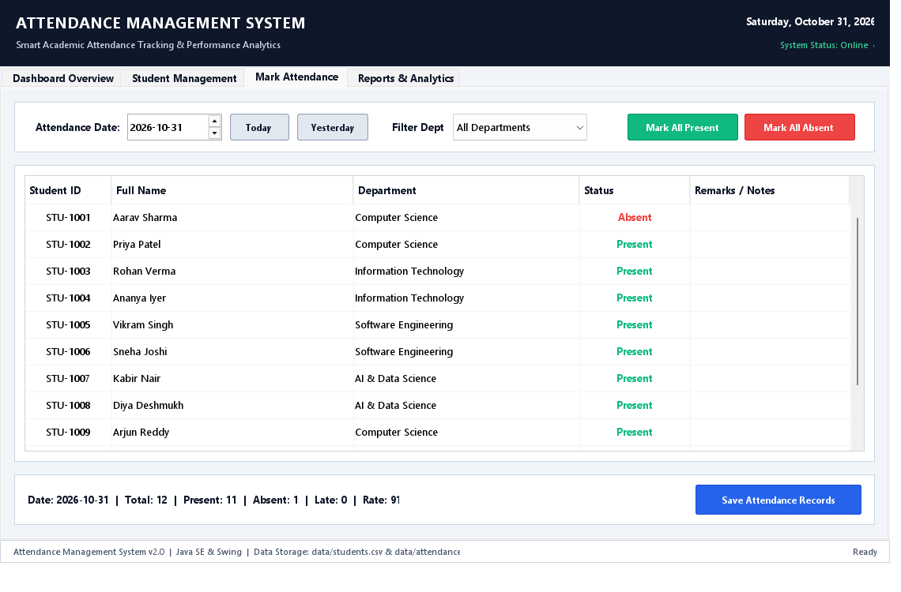
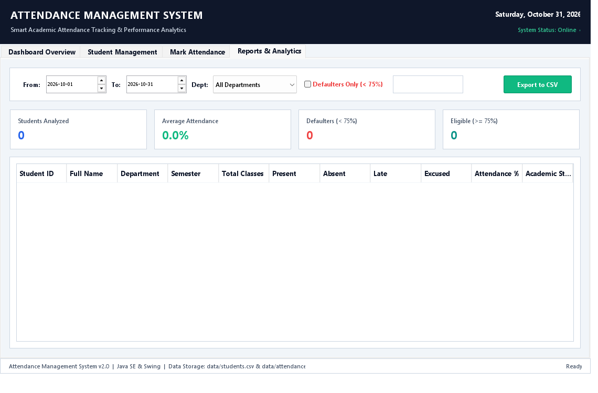

# Attendance Management System

A robust, enterprise-grade desktop **Attendance Management System** built with **Java (Swing GUI)**, following Object-Oriented Programming (OOP) principles, clean Model-View-Controller (MVC) architecture, custom exception handling, and persistent data storage.


---

## 📋 Table of Contents
- [Project Overview](#-project-overview)
- [Key Features](#-key-features)
- [Project Structure](#-project-structure)
- [Architecture & Design](#-architecture--design)
- [Application Screenshots](#-application-screenshots)
- [Prerequisites](#-prerequisites)
- [Compilation and Execution](#-compilation-and-execution)
- [Data Storage & Persistence](#-data-storage--persistence)
- [Exception Handling](#-exception-handling)
- [Project Deliverables](#-project-deliverables)

---

## 📖 Project Overview

The **Attendance Management System** streamlines student attendance tracking, registration, and academic eligibility monitoring for schools, colleges, and university departments. The application provides an intuitive desktop interface with live statistics, batch attendance logging, defaulter detection (< 75% attendance threshold), and one-click CSV report exports.

---

## ✨ Key Features

1. **Dashboard & Analytics**
   - Live KPI overview cards: Total Students, Today's Present, Today's Absent, Average Attendance Rate.
   - Interactive turnout progress meter.
   - Real-time **Defaulters Watchlist (< 75%)** with immediate warning status flags.
   - Quick navigation shortcuts to core modules.

2. **Student Directory Management (`StudentPanel`)**
   - Full student profile management: Student ID, Full Name, Department, Semester, Email.
   - Add new students with uniqueness verification (enforced via `DuplicateStudentException`).
   - In-place profile updating and safe deletion with cascade cleanup.
   - Instant multi-field search and filtering.

3. **Daily Attendance Tracking (`AttendancePanel`)**
   - Calendar date picker with convenient "Today" and "Yesterday" shortcuts.
   - Department-based filtering.
   - Bulk status actions: "Mark All Present", "Mark All Absent".
   - Status categorization: **Present**, **Absent**, **Late**, **Excused** with color-coded badges.
   - Remarks & notes field per student (e.g. medical leaves, bus delays).

4. **Academic Reporting & Auditing (`ReportPanel`)**
   - Custom date-range filtering (From Date to To Date).
   - Defaulter filter toggle (< 75% mandatory attendance bar).
   - Detailed metrics: Total Classes, Present Count, Absent Count, Late Count, Excused Count, Attendance %.
   - Academic Eligibility Badges: **Eligible (>=75%)**, **Warning (<75%)**, **Defaulter / Barred**.
   - Export reports directly to formatted CSV spreadsheets.

---

## 📂 Project Structure

```
AttendanceManagementSystem/
│
├── src/
│   ├── model/
│   │   ├── Student.java                  # Student domain entity model
│   │   └── Attendance.java               # Daily attendance record model
│   │
│   ├── manager/
│   │   └── AttendanceManager.java        # Core business logic, analytics & persistence
│   │
│   ├── gui/
│   │   ├── Dashboard.java                # Main application JFrame and navigation
│   │   ├── StudentPanel.java             # Student directory & profile editor
│   │   ├── AttendancePanel.java          # Daily attendance marking interface
│   │   └── ReportPanel.java              # Analytics, filtering & CSV reporting
│   │
│   ├── exception/
│   │   └── DuplicateStudentException.java # Custom checked exception for ID collisions
│   │
│   └── Main.java                         # Application entry point with EDT bootstrapping
│
├── screenshots/
│   ├── dashboard_overview.png            # Main analytics dashboard screenshot
│   ├── student_management.png            # Student profile directory screenshot
│   ├── mark_attendance.png               # Attendance marking sheet screenshot
│   └── reports_analytics.png             # Reports and statistics view screenshot
│
├── data/
│   ├── students.csv                      # Persistent storage for student profiles
│   └── attendance.csv                    # Persistent storage for daily attendance logs
│
├── README.md                             # Comprehensive project documentation
└── ProjectReport.docx                    # Academic / Final Project Documentation
```

---

## 🏛 Architecture & Design

The application follows the **Model-View-Controller (MVC)** architectural design pattern:



---

## 📸 Application Screenshots

### 1. Dashboard Overview


### 2. Student Directory Management


### 3. Daily Attendance Marking


### 4. Reports & Performance Analytics


---

## ⚙ Prerequisites

- **Java Development Kit (JDK)**: Version 17 or higher (Java 17, 21+ supported)
- **Operating System**: Windows, macOS, or Linux
- **No external jars required**: Built strictly using standard Java SE libraries (`java.desktop`, `java.base`).

---

## 🚀 Compilation and Execution

### Using Windows PowerShell / Terminal

1. **Clone or navigate to the project directory:**
   ```powershell
   cd "Attendance Management System"
   ```

2. **Compile all Java source files:**
   ```powershell
   if (!(Test-Path bin)) { New-Item -ItemType Directory -Path bin }
   javac -encoding UTF-8 -d bin src/model/*.java src/exception/*.java src/manager/*.java src/gui/*.java src/Main.java
   ```

3. **Run the Application:**
   ```powershell
   java -cp bin Main
   ```

---

## 💾 Data Storage & Persistence

Data is automatically persisted to disk in standard CSV format inside the `data/` directory:
- **`data/students.csv`**: Contains student records formatted as `StudentID,Name,Email,Department,Semester`.
- **`data/attendance.csv`**: Contains attendance history formatted as `StudentID,Date,Status,Remarks`.
- If no data files exist on first launch, `AttendanceManager` automatically provisions realistic seed data across multiple academic departments.

---

## 🛡 Exception Handling

- **`DuplicateStudentException`**: Custom checked exception thrown when an attempt is made to register a student with an ID that is already registered.
- Caught gracefully in `StudentPanel` to display an informative error dialog without crashing or corrupting state.
- Input validation protects against empty inputs, invalid dates, and malformed CSV parsing.

---

## 📄 Project Deliverables
- Complete Source Code in `src/` conforming strictly to `main.txt`.
- Generated and validated `ProjectReport.docx` with comprehensive technical details.
- High-resolution UI screenshots in `screenshots/`.
